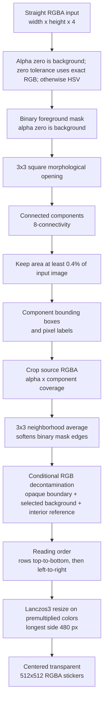
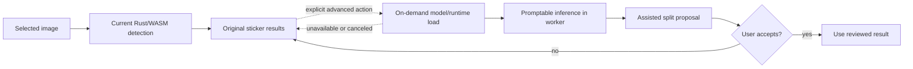
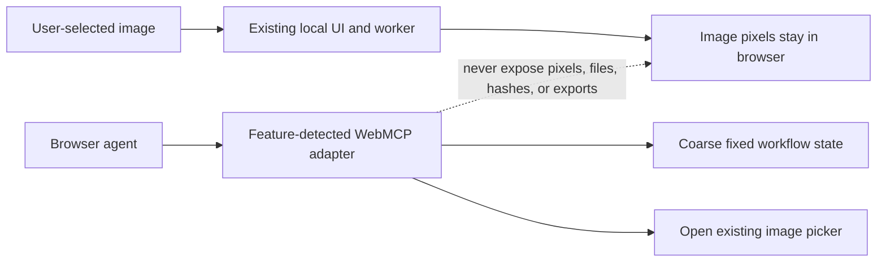

# Architecture

This guide describes the implementation in the repository today. The behavior
contracts in [`openspec/specs/`](openspec/specs/) remain authoritative; when a
detail here disagrees with a contract, resolve the discrepancy in a separate
review instead of silently changing product behavior.

## Goals and boundaries

- Rusticker is a static, client-side web app. Image decoding, detection,
  editing, encoding, ZIP creation, and download happen in the browser.
- The Rust detection core is compiled to WebAssembly and runs in a module Web
  Worker, away from the UI thread.
- User image pixels are not uploaded or sent to a server. The browser may load
  the static app and versioned WebAssembly asset; those application
  resources are separate from user data.
- The Rust core returns error codes, not localized text. The frontend maps
  those codes to Paraglide messages.

## Repository layout

```text
core/
  src/                  Rust detection pipeline and wasm-bindgen interface
  tests/                Synthetic detector tests and optional local sample test
web/
  src/lib/detection/    Worker protocol, scheduling, WASM adapter
  src/lib/tool/         Local image decode and editor utilities
  src/lib/export/       Browser encoding, ZIP creation, and downloads
  src/lib/components/   Svelte editor and design-system components
  messages/             Paraglide catalogs
openspec/
  specs/                Current behavior contracts
  changes/              Proposed and archived work
```

The Rust crate is `rusticker-core`. `wasm-pack build core --target web` emits
the package in the ignored `core/pkg/` directory. The web app consumes that
package through a local Bun dependency; `bun run build:wasm` builds it before
installing the copied package. The app is SvelteKit 2 with Svelte 5, TypeScript,
Vite, Paraglide, and `adapter-static`. Image operations use the Rust `image`
and `imageproc` crates; OpenCV is not a runtime dependency.

## Detection pipeline

`core/src/lib.rs::detect_rgba` validates the input and calls the private `run`
pipeline. The image is a straight RGBA buffer. Fully transparent pixels are
always background, independent of their stored RGB values. At tolerance zero,
classification uses exact RGB equality with the picked color; tolerances 1-100
retain the HSV rule described below. Extraction multiplies source alpha by the
existing 3x3 component coverage. A separate conservative RGB pass can remove a
selected-background mixture from an opaque boundary pixel when a nearby
same-component interior reference confirms the mixture. It never uses geometric
coverage as a physical alpha estimate and leaves uncertain colors unchanged.



The RGB pass operates after component alpha coverage but does not use that
coverage to infer a physical edge opacity. It checks the selected background,
an adjacent background-labeled pixel with nonzero source alpha, an opaque edge
pixel that belongs to the component, and nearby opaque interior pixels from the
same component. At least three interior anchors must agree in all RGB channels;
multicolored or textured neighborhoods are left unchanged. If the edge and
representative fit a bounded mixture of foreground and background within
byte-rounding error, the edge RGB is restored to the reference. Alpha, component
labels, and bounding boxes remain unchanged. Partially transparent source RGB,
transparent-background edges, and ambiguous or textured colors pass through
unchanged. This is a targeted decontamination heuristic, not general foreground
matting.
1. **Background classification** (`color.rs`, `mask.rs`). Fully transparent
   pixels are excluded from the foreground mask. At tolerance zero, visible
   pixels match only when their RGB exactly equals the selected color. At
   tolerances 1-100, RGB is converted to HSV and compared with the selected
   background. With green `0x00FF00` and tolerance 50, the accepted range
   corresponds to hue 70-170 degrees, saturation at least 47%, and value at
   least 24%. This configurable color rule is not a learned or general-purpose
   segmentation model. Smith [1] describes the RGB/HSV transform but does not
   validate Rusticker's thresholds.
2. **Mask cleanup** (`mask.rs`). A 3x3 square opening removes foreground
   features that cannot contain a full 3x3 block. It never adds foreground.
   The operation is `imageproc::morphology::open` with `Norm::LInf` and radius
   1 [2].
3. **Components and size filter** (`components.rs`). Foreground is labeled
   with 8-connectivity. Pixels touching diagonally belong to the same
   component, so stickers that touch or connect remain a single sticker. A
   component is retained when its area is at least 0.4% of the full image.
   The connectivity API is supplied by `imageproc` [3]; the project-specific
   cutoff comes from the implementation, tests, and detection spec, not from
   that library or a paper.
4. **Crop and transparency** (`alpha.rs`). Each crop uses source RGB where
   its component label matches. Output alpha is source alpha multiplied by
   component coverage in a 3x3 neighborhood. Fully transparent source pixels
   remain transparent. This preserves source opacity and softens mask edges,
   but does not infer opacity from image content. Conditional RGB
   decontamination is described above. The matting survey [10] covers a
   different technique family and is listed for comparison only.
5. **Ordering and framing** (`order.rs`, `frame.rs`). Boxes are grouped into
   rows by vertical center: a box joins the current row only while its center
   is strictly above that row's lowest bottom edge. Each row is sorted by
   horizontal center, then top coordinate. Crops are fitted inside 480 × 480
   and centered on a transparent 512 × 512 canvas. Resizing uses Lanczos3 [4]
   on premultiplied colors, then converts back to straight RGBA to avoid color
   bleeding from transparent pixels.

The deterministic pipeline rules are covered by unit and synthetic tests in
`core/src/*` and `core/tests/synthetic.rs`. The integration test in
`core/tests/sample_image.rs` uses its bundled public fixture by default and
can use a private local image when `RUSTICKER_SAMPLE_IMAGE` is set; private
images are not included in CI. Input-alpha behavior is covered by deterministic
unit and synthetic tests. The authoritative current contract is
[`sticker-detection`](openspec/specs/sticker-detection/spec.md).

### Known detection limits

- Fully transparent input pixels are excluded from foreground. Partial alpha
  is preserved during extraction and multiplied by component coverage.
- The mask assumes one mostly uniform background color selected by the user.
  A substantially different or non-uniform background is not segmented
  automatically.
- 8-connected regions are indivisible in the current detector. Distance
  transform and watershed methods are research candidates, not implemented
  steps. Bai and Urtasun's paper [9] is an example of watershed-based instance
  segmentation, not a description of Rusticker's component labeling.
- The 3 × 3 mask average softens geometric edges. A conservative RGB pass
  reduces only opaque boundary colors that match a selected-background mixture
  with a nearby interior reference. It does not estimate physical alpha, solve
  general foreground matting, or resolve an intentionally colored edge that
  is indistinguishable from background spill.

These limitations are tracked by separate roadmap work. Do not read a future
candidate or comparison paper as a claim that the technique is already present.

### ONNX split assistance: feasibility only

The proposed flow keeps the standard Rust/WASM detector first. An optional
advanced action could lazily run a promptable model in the worker only after the
user requests it, then return a proposal for review. The image and prompts stay
local; only versioned model/runtime assets may be fetched. The original result
must remain available if download, initialization, or inference fails. This is
roadmap design, not implemented behavior.



The [ONNX split-assistance evaluation](docs/onnx-split-evaluation.md) recommends
`tract` as the first pure-Rust/WASM runtime proof of concept and ONNX Runtime
Web only as a measured compatibility fallback. No ONNX model has been tested
against Rusticker's sticker fixtures, so neither model-assisted behavior nor
runtime compatibility is claimed today.

### WebMCP: feasibility only

WebMCP is an experimental Community Group draft, and current Chrome
documentation describes an Origin Trial and local testing flag. It is not
required for the app to work. The [WebMCP evaluation](docs/webmcp-evaluation.md)
limits the initial tool surface to the existing image picker and coarse editor
status. An isolated adapter in `web/src/lib/webmcp/` feature-detects
`document.modelContext` and registers those two tools with bounded inputs and
outputs. It is not mounted by the application yet, so the running app currently
registers no WebMCP tools. The consuming editor page must connect callbacks to
its existing picker and state while preserving the full UI fallback. Tools must
never accept or return user image bytes, file names, hashes, sticker pixels, or
derived metadata. Do not expose pack downloads as agent tools.



## Browser, worker, WebAssembly, and export flow

The editor decodes selected, pasted, or dropped image bytes locally. The
browser applies EXIF orientation with `createImageBitmap`, draws to an
`OffscreenCanvas`, and reads an `ImageData` buffer. A defensive copy is then
transferred to the worker so the editor retains its original pixels.

```mermaid
sequenceDiagram
    actor User
    participant UI as Browser UI thread
    participant Worker as Module Web Worker
    participant Core as Rust / WebAssembly
    participant Canvas as Browser canvas encoders
    participant Zip as JSZip
    participant Download as Browser download

    Note over UI,Core: Static UI and WASM assets may be fetched or read from the app cache.
    User->>UI: Choose, paste, or drop an image
    UI->>UI: Decode locally; apply EXIF orientation; create ImageData
    UI->>Worker: Copy RGBA buffer, then transfer with Comlink
    Worker->>Core: Validate input and run detector
    Core-->>Worker: Detection handle, bounding boxes, sticker RGBA
    Worker->>Worker: Copy sticker bytes into JS-owned buffers; free Rust result
    Worker-->>UI: Transfer sticker buffers back
    UI->>User: Preview, remove, choose tray icon, adjust background/tolerance
    UI->>Worker: Re-detect when background/tolerance changes
    Worker-->>UI: Updated local sticker pixels
    loop Each retained sticker
        UI->>Canvas: Encode WEBP and PNG locally
    end
    UI->>Canvas: Resize chosen sticker to 96 × 96 tray PNG
    Canvas-->>UI: Browser Blob objects
    UI->>Zip: Add sticker files and tray icon
    Zip-->>UI: ZIP Blob
    UI->>Download: Create object URL and click a local download link
    Download-->>User: Save ZIP file
    Note over UI,Zip: User image pixels and generated archives stay in the browser.
```

The worker initializes the generated WASM module once. Comlink wraps the worker
API [8], and transferable `ArrayBuffer`s move the input copy to the worker and
the sticker buffers back [7]. The generated bindings provide the JavaScript/Rust
interface [5]. The Rust detection call is synchronous: a newer request cannot
interrupt it. The latest-wins scheduler cancels the old caller, keeps at most
one newest pending request, discards the old result, and starts the pending
request when the in-flight call finishes. A failed worker is terminated and a
fresh one is created for the next request.

Sticker WEBP and PNG encoding uses browser `OffscreenCanvas`; WEBP quality is
searched to fit the WhatsApp size limit when possible. The tray icon is a
96 × 96 PNG. JSZip assembles locale-neutral files in the browser, and the
download helper saves a Blob using an object URL. No user image or output ZIP
is sent to a remote service. Worker and transfer semantics are documented by
the [Web Workers API](https://developer.mozilla.org/en-US/docs/Web/API/Web_Workers_API),
[transferable objects](https://developer.mozilla.org/en-US/docs/Web/API/Web_Workers_API/Transferable_objects),
and [Comlink](https://github.com/GoogleChromeLabs/comlink).

The worker's WASM file and other application resources are static site assets.
The service worker can cache application files for offline use; this does not
mean the application uploads user images.

## Errors and user-facing messages

The Rust core returns `NoStickers`, `ImageTooLarge`, or `InvalidInput` for
detector failures. The TypeScript runtime maps these codes to localized
messages. `WorkerFailed` represents worker startup, runtime, or crash failures
at the browser boundary. The core performs no file or network I/O and returns
no user-facing text.

## Export contract

- Each sticker is a transparent 512 × 512 WEBP and also has a lossless 512 ×
  512 PNG copy in the archive.
- The browser tries to keep static WEBP files at or below 100,000 bytes. If
  quality reaches its configured floor and the result is still larger, the
  sticker remains included and the UI reports the over-limit count.
- Packs contain 3–30 stickers. More than 30 are split into balanced packs in
  detection order; fewer than 3 block export.
- Each archive contains its numbered WEBP and PNG stickers plus
  `tray_icon.png`. File numbering restarts at `01` in each pack.
- Export results are cached only in the current browser session and invalidated
  when sticker pixels or the tray selection change. An active export is
  cancelled when its view is destroyed.

The detailed contract is in
[`sticker-export`](openspec/specs/sticker-export/spec.md).

## Static app and tests

The SvelteKit app is built as a static site for GitHub Pages. The service worker
supports offline use after application assets have been cached. The relevant
behavior contract is [`offline-install`](openspec/specs/offline-install/spec.md).

The Rust unit and synthetic integration tests cover deterministic detection
rules. Web tests cover editor state, worker scheduling and recovery, browser
encoding, and archive contents. The private sample-image test is skipped when
its local path environment variable is unset and is never required in CI.

## References

These sources explain the named model, API, or comparison technique. They do
not independently validate project-specific thresholds or outcomes; those
are established by the code, tests, and OpenSpec contracts.

1. Alvy Ray Smith, [“Color Gamut Transform Pairs”](https://doi.org/10.1145/965139.807361), *ACM SIGGRAPH Computer Graphics*, 1978. Defines RGB/HSV transform pairs; cited for color-space context only.
2. [`imageproc 0.25.1`: `morphology::open`](https://docs.rs/imageproc/0.25.1/imageproc/morphology/fn.open.html). Documents erosion followed by dilation; Rusticker supplies the 3 × 3 square via `Norm::LInf` and radius 1.
3. [`imageproc 0.25.1`: `region_labelling::connected_components`](https://docs.rs/imageproc/0.25.1/imageproc/region_labelling/fn.connected_components.html). Documents connected-component labeling; Rusticker selects `Connectivity::Eight`.
4. [`image 0.25.10`: `FilterType::Lanczos3`](https://docs.rs/image/0.25.10/image/imageops/enum.FilterType.html). Identifies the Lanczos window-3 sampling filter used by the framing code; premultiplication is implemented by Rusticker.
5. [The `wasm-bindgen` Guide](https://rustwasm.github.io/docs/wasm-bindgen/). Documents Rust/JavaScript bindings and the WebAssembly interface.
6. [MDN: Web Workers API](https://developer.mozilla.org/en-US/docs/Web/API/Web_Workers_API). Documents running JavaScript in a background worker context.
7. [MDN: Transferable objects](https://developer.mozilla.org/en-US/docs/Web/API/Web_Workers_API/Transferable_objects). Documents transferring ownership of buffers between execution contexts.
8. [Comlink](https://github.com/GoogleChromeLabs/comlink). Documents the proxy-based worker API used by the frontend.
9. Min Bai and Raquel Urtasun, [“Deep Watershed Transform for Instance Segmentation”](https://arxiv.org/abs/1611.08303), arXiv:1611.08303 (2016). A comparison/future-work reference for watershed-based instance segmentation; Rusticker does not implement this method.
10. Jizhizi Li, Jing Zhang, and Dacheng Tao, [“Deep Image Matting: A Comprehensive Survey”](https://arxiv.org/abs/2304.04672), arXiv:2304.04672 (2023). Surveys image-matting methods; Rusticker's local binary-mask average is not one of those learned matting methods.
