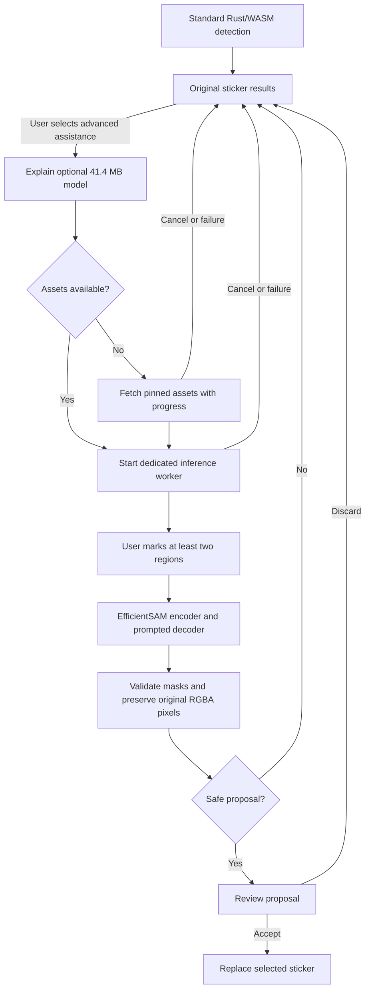

## Context

The standard detector uses connected components in Rust/WASM and intentionally does not split touching foreground. Existing editor state already supports a deterministic split proposal, review, accept, discard, and undo. Existing detector calls use one long-lived Comlink worker; terminating it to cancel model inference would also destroy the normal detector. The new inference path must therefore be separate and lazy.

The #54 evaluation documented `tract` as the preferred pure-Rust/WASM runtime to test, with ONNX Runtime Web as a compatibility fallback. The official EfficientSAM project documents separate ONNX encoder and decoder graphs and point/box prompts. The model card for `yunyangx/EfficientSAM` identifies Apache-2.0; the exact immutable revision and file hashes below are required for any use. The paper reports generic segmentation results, not sticker-splitting quality, so synthetic sticker fixtures remain the deciding evidence.

## Goals and non-goals

**Goals:** prove the exact paired model works in Rust/WASM if `tract` can support its graphs; use ONNX Runtime Web only as a measured fallback if the Rust/WASM route is blocked; evaluate the selected route on reproducible synthetic sticker pairs; offer an explicit, cancelable, user-reviewed split proposal only if it improves relevant fixtures without unsafe false splits; preserve standard detection and privacy.

**Non-goals:** automatic proposals for every sticker, training a new model, replacing deterministic detection, changing the standard result without consent, analytics, remote inference, or a release.

## Model and runtime pin

- Model: EfficientSAM-Ti, point-prompted image segmentation.
- Repository: `https://huggingface.co/yunyangx/EfficientSAM`.
- Immutable repository revision: `d53228e3f6dee607309453f54a22c40c2a10204c`.
- Encoder: `efficientsam_ti_encoder.onnx`, 24,799,761 bytes, SHA-256 `84ed466ffcc5c1f8d08409bc34a23bb364ab2c15e402cb12d4335a42be0e0951`.
- Decoder: `efficientsam_ti_decoder.onnx`, 16,565,728 bytes, SHA-256 `a62f8fa5ea080447c0689418d69e58f1e83e0b7adf9c142e2bd9bcc8045c0b11`.
- Combined download: 41,365,489 bytes (about 41.4 MB decimal). Include Apache-2.0 attribution and model provenance with any redistributed assets.
- Primary references: [EfficientSAM source](https://github.com/yformer/EfficientSAM), [official ONNX example](https://github.com/yformer/EfficientSAM/blob/main/EfficientSAM_onnx_example.py), [pinned model files and metadata](https://huggingface.co/yunyangx/EfficientSAM/tree/d53228e3f6dee607309453f54a22c40c2a10204c), [paper](https://arxiv.org/abs/2312.00863).
- Runtime references: [`tract` 0.23 changelog](https://github.com/sonos/tract/blob/main/CHANGELOG.md), [`tract` architecture/API guide](https://github.com/sonos/tract/blob/main/doc/intro.md).
- Preferred runtime: pin the stable `tract` facade version used by the proof of concept and compile it as an optional, separate WASM package. Do not add it to the standard detector WASM artifact. If a reproducible graph limitation prevents this, ONNX Runtime Web's CPU-only WASM distribution is the evaluated fallback; it must remain lazy-loaded in a separate worker and must not enter the standard detector bundle.

Before UI work, verify both hashes, inspect model graph signatures/opsets, load and optimize both graphs with `tract`, compile the exact crate for `wasm32-unknown-unknown`, and execute the pair in a real browser worker. Record unsupported operators/attributes and compare outputs against the upstream ONNX Runtime reference. If and only if `tract` has a demonstrated blocker, test the same graph pair with ONNX Runtime Web WASM and document why the pure-Rust runtime cannot satisfy this feature. Do not interpret an ONNX Runtime Web smoke test as evidence that it improves sticker splitting.

## Proposed flow

The image and prompts travel only from the editor to a dedicated worker. Model/runtime assets are versioned static resources and may be fetched only after the explicit user action. The current ONNX Runtime Web CPU/WASM probe required 55,679,893 bytes uncompressed for the two models, runtime JavaScript glue, and WASM binary. Do not include the models or optional runtime/WASM chunks in the initial PWA precache. Load assets with size progress, cancellation, SHA-256 verification, and a versioned on-demand cache; quota/cache failures must fall back to an in-memory run or the standard result.

The proposed interaction lets the user mark a positive point in each intended sticker region. Confirm the exact decoder point-label contract and output shapes from the pinned graphs before implementing. Reconcile masks deterministically against the selected sticker's original alpha mask; reject a proposal if overlap, uncovered foreground, or empty regions exceed measured safety thresholds. Candidate RGB and alpha come from the original sticker, never from model-generated pixels. Keep the original result untouched until accepted and reuse the editor's established review/undo behavior where possible.

Use a dedicated assistant worker so cancel can terminate synchronous WASM inference without terminating standard detection. Associate each request with the editor image generation, source sticker ID, and assistant job ID; ignore stale completions after image replacement, source removal, overlay dismissal, or cancellation.

## Quality and performance gates

Use deterministic generated masks only: touching pairs, narrow bridges, overlaps, concavities, holes/rings, stars, transparent edges, varied scale/rotation, and single-object controls. Compare the existing detector/proposal and assisted output with instance-count correctness, false-split/merge rate, matched mask IoU, and boundary F1. Preserve held-out seeds and set thresholds before tuning. Do not treat generic EfficientSAM paper metrics as sticker evidence.

Measure model bytes, optional runtime bytes, cold load, cold/warm inference, peak memory, browser worker cancellation, quota behavior, and offline second use on desktop and a low-resource mobile browser. If the model cannot improve sticker fixture quality within the recorded browser budget, leave the user-facing action disabled and report the blocker instead of shipping an inert affordance.

## Risks and mitigations

- **Graph or WASM incompatibility:** exact pinned graph test is an early gate; compare the same graphs with ONNX Runtime Web only if a specific `tract` gap is recorded.
- **Promptable masks may not separate stylized stickers:** use two-region prompts, preserve all original pixels, reject unsafe masks, and require user review.
- **Download and memory cost:** disclose 41.4 MB before download, keep assets out of initial install/precache, and measure low-resource devices.
- **Cancellation of synchronous WASM:** isolate the assistant in a disposable worker and abort model fetches.
- **Model provenance:** keep revision, hashes, Apache attribution, and source links beside the asset manifest.
- **Privacy:** do not send images, prompts, masks, or embeddings in any request; test with network inspection and offline cache behavior.
## Runtime evaluation update

The pinned encoder and decoder downloads match their published sizes and SHA-256 hashes. `tract` 0.23.8 loads and optimizes the encoder when its dynamic input is fixed to `[1, 3, 1024, 1024]`; decoder preparation fails at `/Resize` with `Neither sizes nor scales makes sense` for input `[1, 3, 256, 256]`, despite fixed point-prompt input dimensions. A temporary native harness did prepare and execute the decoder when it also specialized the `orig_im_size` input to a concrete value (`[512,512]` or `[1024,1024]`) through `tract-hir`/`tract-core` internals. It returned logits with static output shapes `[1,1,3,512,512]` and `[1,1,3,1024,1024]` using a synthetic zero embedding. A runtime `orig_im_size` different from the specialization did not change the output shape, confirming that each resolution needs its own specialized plan. The stable `tract` facade exposes no supported input-value specialization API, so the next Rust/WASM test is to bake this fixed size into a separate decoder model or isolate preprocessing/postprocessing around a fixed-resolution model. The encoder-to-decoder path has not yet completed in `tract`; native encoder inference exceeded 90 seconds in this environment.

A separate `wasm32-unknown-unknown` compile of the temporary `tract` harness stopped before compiling `tract`: its `psm` dependency requires `clang` and `ar`, which are absent from this environment. The harness also identified a follow-up `getrandom` requirement to enable `wasm_js` for this target. These are build-configuration/toolchain blockers, not proof that the crate cannot compile with the required C toolchain and features.

The exact pair did load and execute in Chromium through ONNX Runtime Web 1.30.0's CPU/WASM distribution, including from a dedicated module worker. The input contract matched the upstream example: RGB planar float32 image values in `[0,1]`, decoder point coordinates and float labels, and `orig_im_size` as two int64 values. With one WASM thread on this desktop, measured encoder inference was 8.3-10.6 seconds for the tested 512-1024 pixel synthetic images; decoder inference was about 0.2-0.25 seconds. The outputs had the expected embedding `[1,256,64,64]`, masks `[1,1,3,H,W]`, and three candidate scores. This confirms graph/runtime compatibility only; scores are not ground-truth quality metrics.

The total uncompressed CPU/WASM runtime plus model assets was 55,679,893 bytes: runtime glue `ort.wasm.min.mjs` 50,126 bytes, WASM glue `ort-wasm-simd-threaded.mjs` 24,381 bytes, WASM binary 14,239,897 bytes, encoder 24,799,761 bytes, and decoder 16,565,728 bytes. No CDN or user-data network request was used. Keep this entire path opt-in and outside the initial bundle and PWA precache.

The mask-quality gate failed on a reproducible synthetic control run using the exact pinned model hashes. The independent harness used 512x512 RGB planar input divided by 255, `[x,y]` points, float labels `1`/`0`, `orig_im_size=[512,512]`, and a `logit > 0` mask threshold, matching the official example's preprocessing and prompt contract. On a single disk, the best-score mask had pixel IoU `0.0674` against the ground truth despite the model's predicted score of `0.9881`. On separated disks, the selected masks for the two opposite prompts had IoUs near `0.496` and overlapped on `98.58%` of the foreground. Touching disks with same and different colors produced the same behavior: IoUs near `0.497` and overlap above `98.5%`. Thus the model's own scores do not validate the output, and it did not separate even these simple instances. These controls do not prove how it behaves on every sticker, but they are sufficient to fail the current candidate's quality gate.

Do not expose or ship an assisted split with this model. If model work resumes, first set acceptance thresholds before tuning: the single-object control must remain one mask with IoU at least `0.90`; each prompted instance must reach IoU at least `0.80` against its own ground truth; and the two proposed masks must overlap on no more than `10%` of their union. Include false-split/merge and boundary-F1 measurements on held-out generated sticker shapes. The fallback remains technically executable, but EfficientSAM-Ti is not approved for product implementation based on the current evidence.
